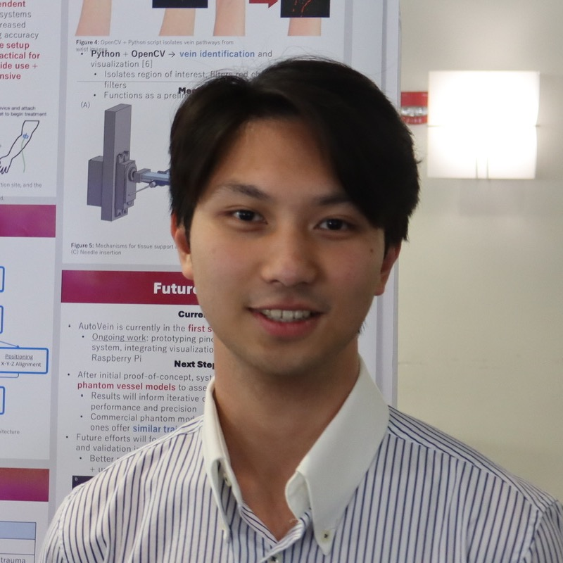

  

    
  

  

    <h3>Jinwei Zhang</h3>
    
Principal Investigator

    
Jinwei Zhang is an Assistant Professor in the Department of Biomedical Engineering at the University of Massachusetts Amherst and leads the Intelligent MRI Lab. Zhang received B.S. degrees in Optical Information Science and Technology and Information and Computational Science from Sun Yat-sen University, and M.S. and Ph.D. degrees in Biomedical Engineering from Cornell University. Before joining UMass Amherst, Zhang completed postdoctoral training in Electrical and Computer Engineering at Johns Hopkins University. The lab focuses on quantitative MRI, computational imaging, neuroimaging analysis, and AI methods for clinically relevant imaging problems.

  

## Lab Members

  

    
  

  

    <h3>Ziqian Ye</h3>
    
Research Assistant

    
Ziqian Ye received his B.S. in Biomedical Engineering from Southeast University and his M.S. in Biomedical Engineering from Johns Hopkins University. He is currently a Research Assistant in the Intelligent MRI Lab at UMass Amherst. His research interests include MRI reconstruction and quantitative imaging, with a particular focus on SWI and QSM reconstruction using deep learning methods.

  

  

    
  

  

    <h3>Yesutorwu Dzidzornu</h3>
    
Research Assistant

    
Yesutorwu Dzidzornu holds a Bachelor of Science in Sports Biology from Springfield College. His interests lie at the intersection of medicine, artificial intelligence, and design, with a growing focus on medical imaging and neurosurgery. He is currently working on automatic segmentation of hippocampal subfields using ASHS, with an interest in improving MRI image quality. Outside of research, he enjoys graphic design, playing the keyboard, producing music, and has experience supporting individuals with special needs and mental health conditions.

  

  

    
  

  

    <h3>Richaphum (Paul) Udompornwirat</h3>
    
Undergraduate Student

    
Richaphum (Paul) Udompornwirat is an undergraduate Honors student in Biomedical Engineering at UMass Amherst who is passionate about developing technology for medical applications. In the lab, his research focuses on domain-generalizable deep learning methods for accelerated MRI reconstruction. He is also interested in medical robotics, including surgical robots and MRI-guided interventions. Beyond the lab, he is an active member of the UMass MedTech Team and the UMass Robotics Club.

  

  

    
  

  

    <h3>Ava Lewenczuk</h3>
    
Undergraduate Student

    
My name is Ava Lewenczuk, and I am an undergraduate student studying Biomedical Engineering at UMass Amherst. I am currently working on the MS vs. CSVD lesion project in the Intelligent MRI Lab, which focuses on analyzing lesion characteristics and morphology to improve the understanding and differentiation of multiple sclerosis and cerebral small vessel disease. I am particularly interested in neuroscience and exploring engineering based approaches to better understand neurological disorders and ultimately improve neurological health.

  

